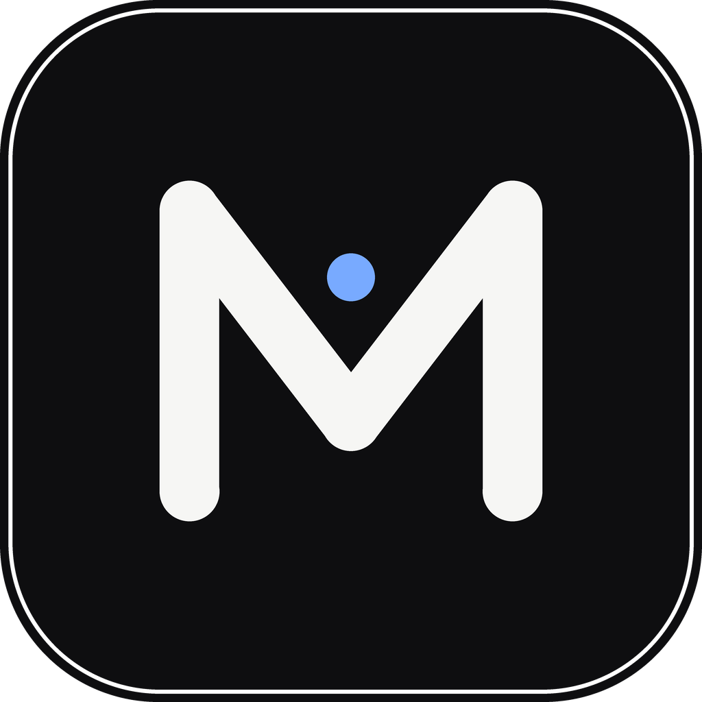

<p align="center">
  
</p>

<h1 align="center">Mnemo</h1>

<p align="center">
  <b>Локальный поиск по всему компьютеру: имена файлов, содержимое, текст на картинках (OCR) и ответы локальной нейросети.</b><br/>
  Данные не покидают вашу машину.<br/>
  Русский · <a href="README.en.md">English</a>
</p>

---

## Что это

Настольное приложение для Windows (Tauri 2 + React + Rust). Оно строит один локальный индекс ваших дисков и ищет по нему мгновенно.

- **Имена файлов**: быстрый индекс в памяти и небольшой язык запросов.
- **Содержимое**: текст, PDF, документы Office и код извлекаются и индексируются полнотекстово (tantivy).
- **Изображения**: встроенный OCR (пакеты PP-OCR и Indra) делает текст на картинках искомым.
- **Гибридный поиск**: полнотекст плюс векторный поиск, результаты объединяются через RRF.
- **Ask**: вопросы к локальной LLM, которую запускаете вы сами (любой OpenAI-совместимый сервер на `127.0.0.1`), со сверкой цитат с проиндексированными источниками.
- **Активность**: необязательный учёт активных окон и импорт истории браузера с фильтрами приватности.
- **Шифрование на диске**: индекс зашифрован ключом, защищённым Windows DPAPI.
- **Агенты**: MCP-сервер и CLI только для чтения дают локальным ИИ-агентам доступ к тому же индексу.

## Установка

Скачайте файл со страницы [Releases](../../releases):

| Файл | Что это |
|---|---|
| `Mnemo_1.0.0_x64-setup.exe` | Установщик (NSIS). Удаление также стирает индекс и настройки. |
| `Mnemo-portable.exe` | Портативная версия без установки. |

Сборки **не подписаны**, поэтому SmartScreen предупредит при первом запуске («Подробнее» → «Выполнить в любом случае»).

При первом запуске выберите папки и нажмите «Проиндексировать». Если позже изменить список папок в «Настройки → Сохранить → Проиндексировать», снова откроется окно с прогрессом.

## Приватность

- Нет телеметрии, аналитики, аккаунтов, внешних шрифтов и CDN.
- Индекс лежит в `%APPDATA%\mnemo`; удаление данных из приложения стирает их полностью.
- Сеть используется только по вашему действию (загрузка пакетов OCR и моделей, подключение Ask к серверу модели). Подробности: [docs/PRIVACY.md](docs/PRIVACY.md).
- Автопроверка обновлений в этой сборке отключена.

## Сборка из исходников

Нужны Rust (тулчейн MSVC) и Node.js 20+.

```bash
npm install
npx vite build
npx tauri build --bundles nsis --config '{"build":{"beforeBuildCommand":""}}'
```

Проверки этого релиза: `cargo fmt --check`, `cargo clippy --all-targets -- -D warnings`, `cargo test`, `cargo deny check`.

## Происхождение и лицензия

Mnemo построен на основе проекта Kensaku под лицензией MIT (© 2026 Yash Jangid) с существенными изменениями. Лицензия MIT, см. [LICENSE](LICENSE).
